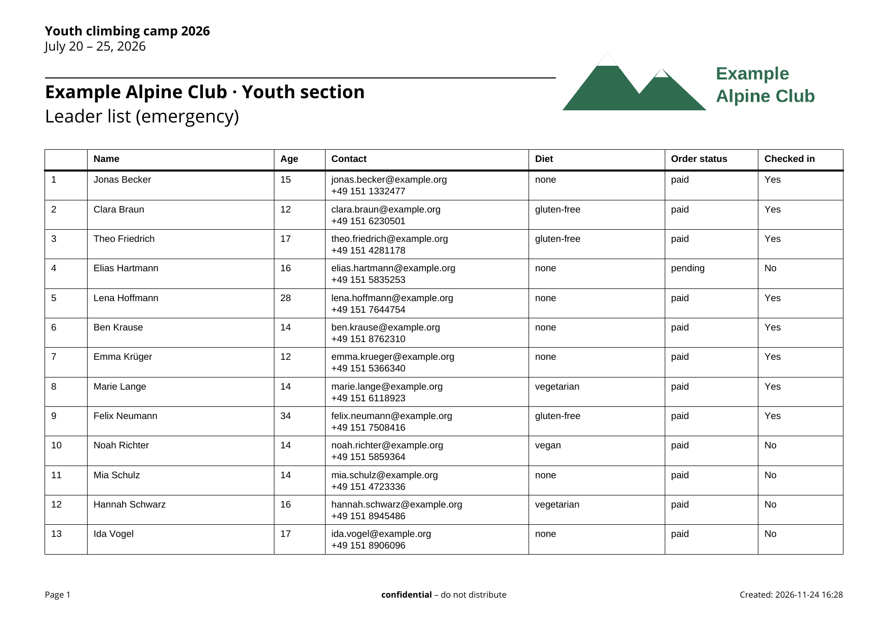
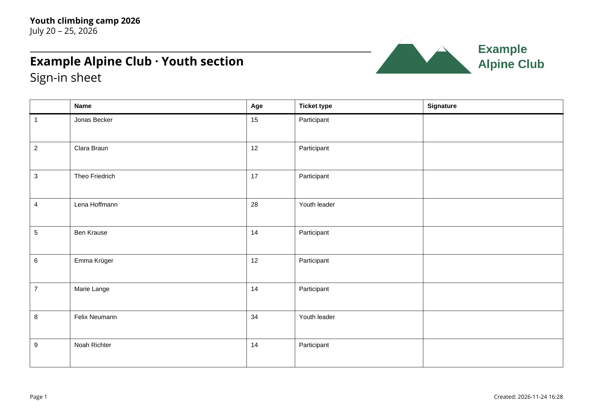
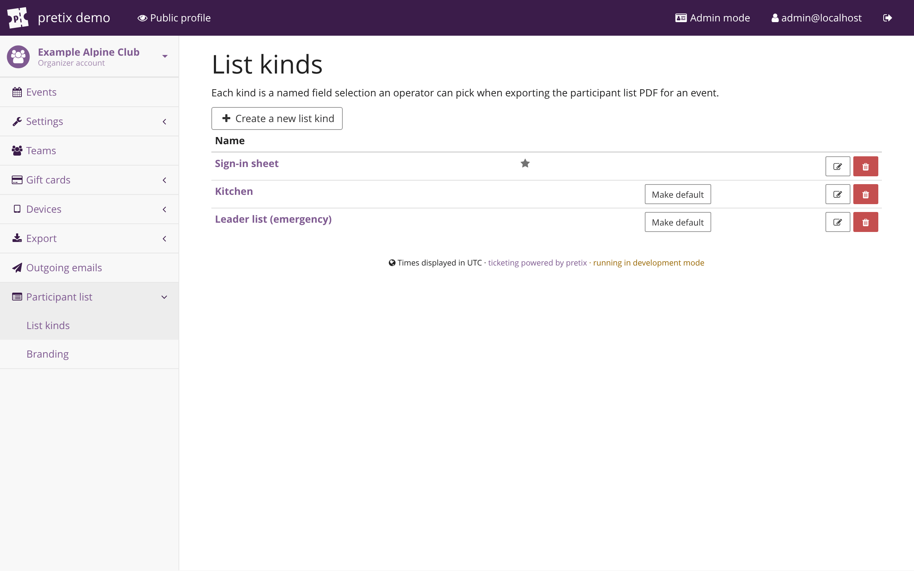
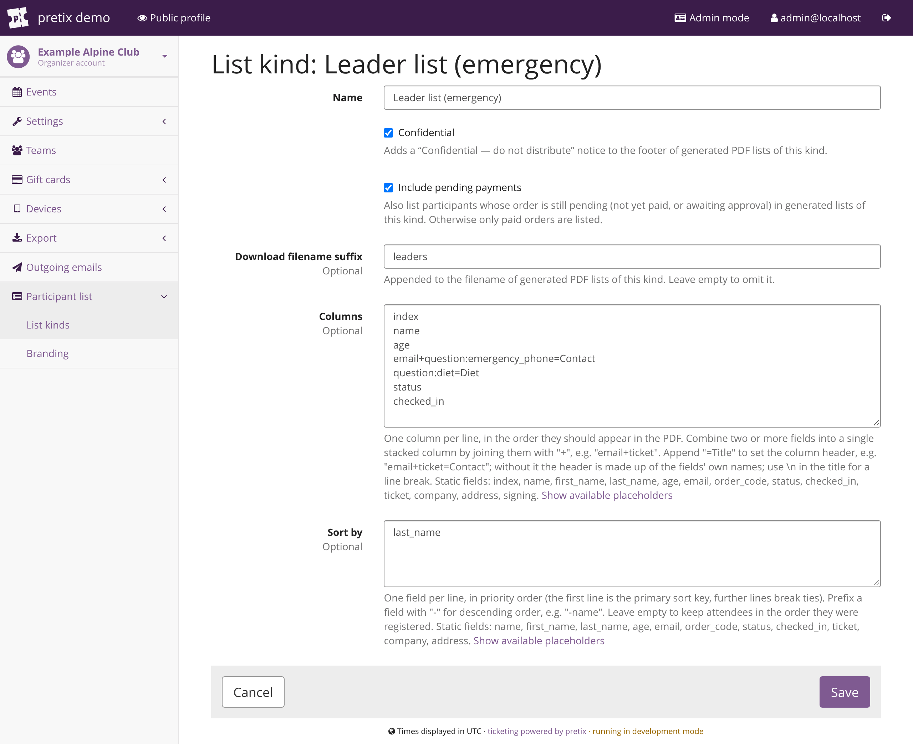
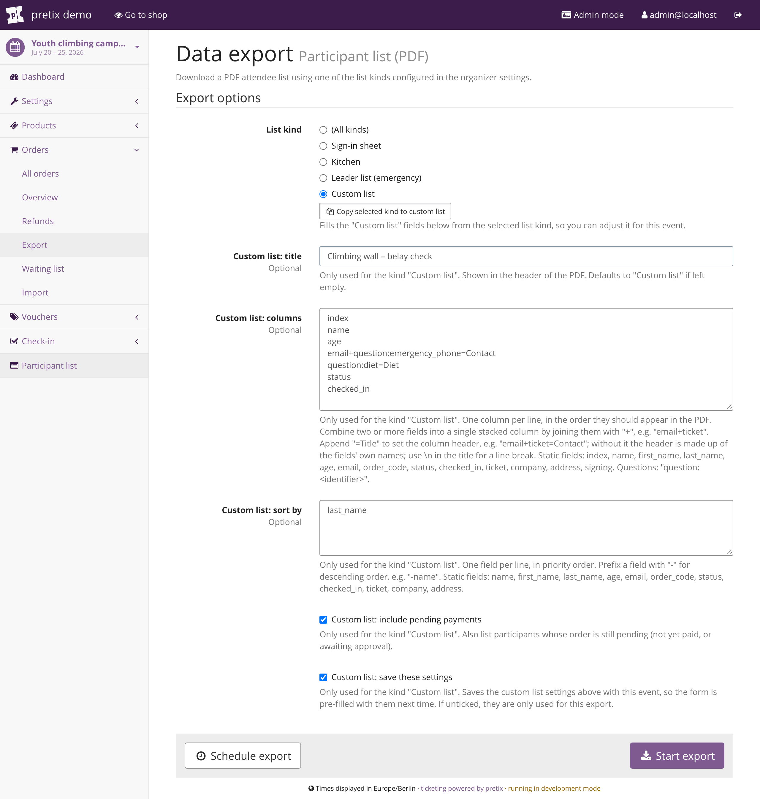
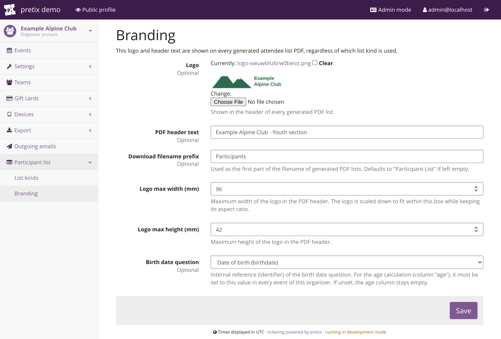
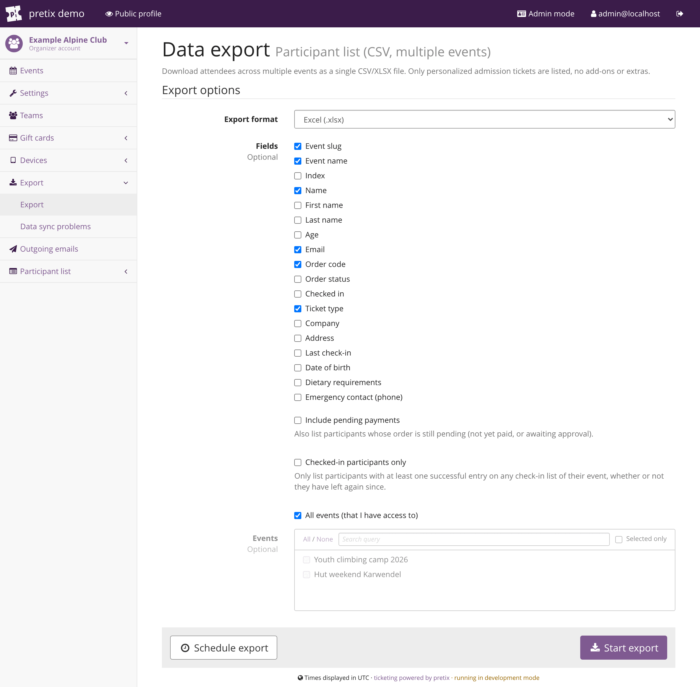

Participant List Export
==========================

This is a plugin for `pretix`_. 

Exports attendees as customizable participant lists (PDF and CSV)

Features
--------

- **PDF participant list** for a single event (landscape A4), available in the
  event's export page and as a shortcut in the event menu.
- **List kinds**: named column selections that an organizer defines once and
  that are then available in every event, each with an optional sort order,
  download filename prefix/suffix, a "confidential" marker and an option to
  also list participants whose order is still pending (unpaid); by default only
  paid orders are listed.
- **Custom list**: per event, columns can also be typed in directly, one per
  line. Join fields with ``+`` to stack them in one column and append ``=Title``
  to set the column header, e.g. ``email+ticket=Contact``. A button on the
  export page copies a list kind into the custom list fields as a starting
  point; the custom list is only remembered for the event if "save these
  settings" is ticked.
- **Fields**: index, name, first/last name, age, email, order code, order
  status, checked in (yes/no), ticket type, company, address, a signature column and any question
  with an identifier (``question:<identifier>``). The age is computed from the organizer-wide
  birth date question.
- **Branding**: logo and header text of the PDF, configured per organizer.
- **CSV/XLSX export** across multiple events, one row per personalized
  admission ticket (add-ons and other extras are left out), with the event
  (slug and name) of each participant and the last check-in time as extra
  fields, optionally
  limited to participants who have checked in.
- **Check-in list**: "checked in" (PDF, CSV, order list) means at least one
  successful entry, whether or not the person has left again since. The PDF
  export page has a field to choose the check-in list that counts; the choice
  is saved with the event and also used by the multi-event CSV export (for
  each event its own saved list) and the order list. By default, entries on
  any check-in list count. A list deleted since counts as "any list"; when an
  event is copied, the copy uses its own copy of the list.
- **Order list** (*Orders → Orders by attendee*, see below).

The plugin is activated for the organizer and then available in all its events.

Order list
----------

The page **Orders → Orders by attendee** in every event lists the orders like
pretix' own order list, but shows the attendees of each order instead of the
email address and the invoice name. It was previously the separate plugin
pretix-ordersummary.

Columns:

- **Order code**, linked to the order.
- **Attendee**: the attendee names of all tickets of the order, without
  duplicates and without add-on products. Only if no ticket has a name, the
  name of the linked customer account is used, and after that the name (or
  company) of the invoice address. An icon marks these fallbacks.
- **Order date** (optional, shown by default).
- **Payment method** (optional, shown by default): the methods of all paid
  payments (including payments refunded later), or, if nothing is paid yet,
  the method of the newest open payment.
- **Question columns** (optional): each cell shows the answers of all tickets
  of the order (add-ons included), without duplicates. Questions asked once
  per order are supported, too.
- **Age** (optional): from the organizer-wide birth date question (see
  *Branding*), the age on the first day of the event, or in an event series
  on the date of the ticket, in the event's time zone. One age per attendee
  (add-ons ignored); equal ages are not merged. Sorting by age sorts by date
  of birth. Hidden if the event has no date question with that identifier.
- **Check-in** (optional, check-in list as chosen on the PDF export page):
  whether the attendees have ever entered. Exits, failed scans and add-on
  products are not taken into account. With one attendee the cell shows a
  check mark, with several attendees "entered / total", e.g. "1 / 2".
- **Status**, as in pretix' order list.

The optional columns are switched on under *Settings → Orders by attendee*.

Canceled tickets are only used if all tickets of an order are canceled. The
search box finds orders by order code, email, attendee, customer account or
invoice name. The status filter hides canceled orders by default, including
orders canceled with a paid fee; "Paid" does not include those.

Filter, search, sort arrows and page navigation update only the table, without
reloading the page (``static/pretix_participantlist/orderlist.js``). Without
JavaScript, everything works as normal links and forms. All columns except the
payment method can be sorted. Attendee and question columns sort by the first
value shown, ignoring case; answers are sorted as text, so numbers sort like
"10" before "9". The check-in column sorts by the number of attendees who have
entered.

Permissions: viewing the list needs the permission to view orders; its
settings page needs the permission to change the general event settings.

Screenshots
-----------

All names, addresses and phone numbers are made up.

**Generated PDF**: a list kind with stacked columns, pending orders included and
the "confidential" footer, and a sign-in sheet with a signature column.

**List kinds** (organizer settings): the default kind is marked with a star.

**Export page** of an event: pick a list kind, or copy one into the custom list
and adjust it for this event.

**Branding** (organizer settings): logo, header text, filename prefix and the
birth date question used for the age column.

**CSV/XLSX export** across multiple events (organizer export page).

Development setup
-----------------

1. Make sure that you have a working `pretix development setup`_.

2. Clone this repository.

3. Activate the virtual environment you use for pretix development.

4. Execute ``pip install -e .`` within this directory to register this application with pretix's plugin registry.

5. Execute ``make`` within this directory to compile translations.

6. Restart your local pretix server. You can now use the plugin from this repository for your events by enabling it in
   the 'plugins' tab in the settings.

This plugin has CI set up to enforce a few code style rules with `Ruff`_. To
check locally, you need it installed::

    pip install ruff

To check your plugin for rule violations, run::

    ruff format --check .
    ruff check .

You can auto-fix most of these issues by running::

    ruff format .
    ruff check --fix .

To automatically check for these issues before you commit, you can run ``.install-hooks.sh``.

Commits in this repository follow `Conventional Commits`_ and releases are
cut with `Commitizen`_ (``cz bump``), which updates the version in
``pyproject.toml`` and ``pretix_participantlist/__init__.py``, writes
``CHANGELOG.md`` and creates the matching git tag. The version starts at
0.1.0; while it is 0.x, breaking changes bump the minor version.

Quick start without a pretix checkout
-------------------------------------

To run the tests and the style checks you do not need a full pretix development
setup. With `uv`_, a few commands create a throwaway environment that contains
the plugin and pretix from its git master branch::

    uv venv
    source .venv/bin/activate
    uv pip install -e . --group dev --group test
    make
    pytest tests
    ruff check .

``make`` needs GNU gettext (Debian package ``gettext``). To try the plugin in a
running pretix, use the development setup above instead.

License
-------

Copyright 2026 ET15

Released under the terms of the Apache License 2.0

.. _pretix: https://github.com/pretix/pretix
.. _pretix development setup: https://docs.pretix.eu/en/latest/development/setup.html
.. _Ruff: https://docs.astral.sh/ruff/
.. _uv: https://docs.astral.sh/uv/
.. _Conventional Commits: https://www.conventionalcommits.org/
.. _Commitizen: https://commitizen-tools.github.io/commitizen/
